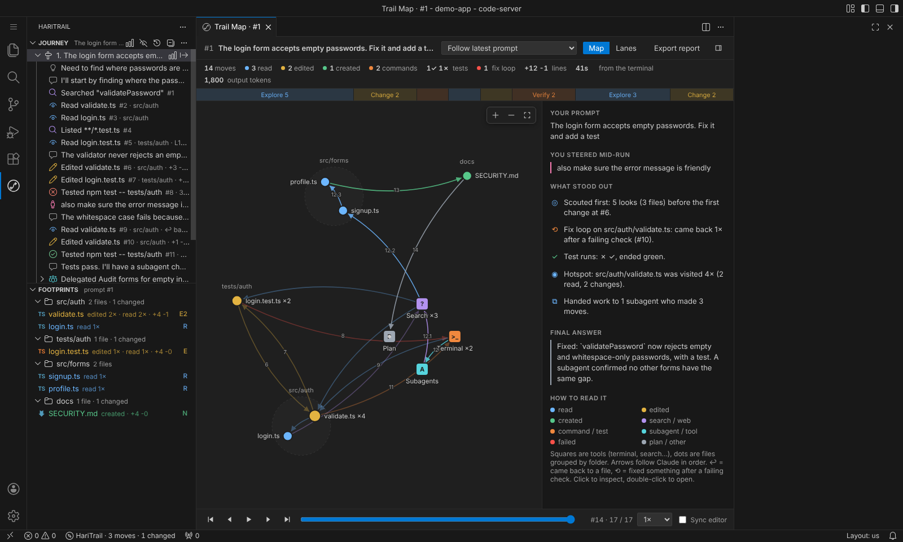
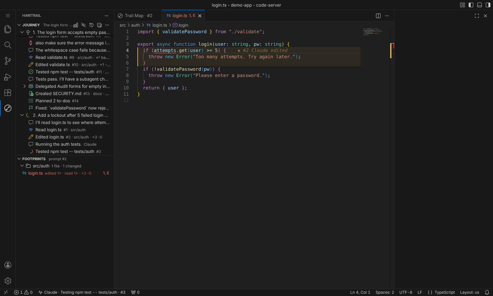
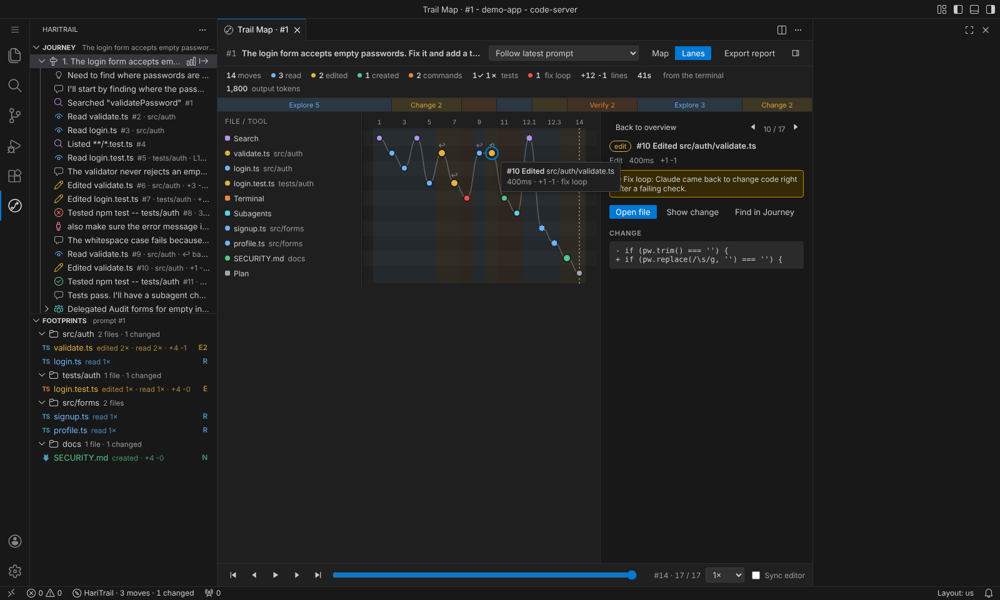
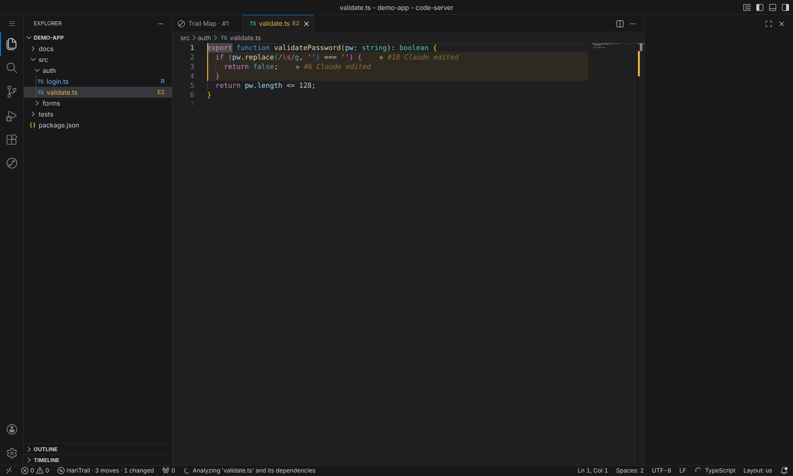

# HariTrail

See how Claude Code works through your code, live.

HariTrail is a VS Code extension that shows what Claude Code does after you send a prompt: every file it reads, edits and creates, every search, command and test it runs, when it hands work to a subagent, and when it goes back to fix something after a failure. You can follow it as a step-by-step journey, as a map of your codebase, or as lanes over time, and replay any prompt afterwards.

It works with Claude Code in the terminal and with the Claude Code chat panel in VS Code. HariTrail reads the session history Claude Code already saves on your machine, so there is no proxy, no API key and nothing to configure in Claude Code. Nothing leaves your computer.



## Features

### Journey
A sidebar view with every prompt you sent and, under each one, every move Claude made, in order.

- What Claude said right before each move, and its visible thinking when the session has it, so you can see why it made the move.
- Plain verbs you can scan: Read, Edited, Created, Searched, Ran, Tested, Delegated.
- `↩ back from #3` when Claude returns to a file, and `⟲ after failure` when it changes code right after a failing check (a fix loop).
- Test runs marked as passing or failing.
- Subagent moves nested under the task that started them.
- Messages you typed while Claude was working, shown where they happened.
- Claude's final answer at the end.
- Where the prompt came from: terminal, VS Code chat panel or desktop app.

Click a move to jump to the exact lines. The inline buttons open the full before and after diff of a change, or the output of a command.



### Trail Map
An editor tab that draws your codebase as a map. Files are dots grouped by folder, tools (terminal, search, web, subagents) are squares in the middle, and Claude's path is drawn between them in order. Each hop curves to the left of its direction, so trips there and back stay readable.

- Lanes view: one lane per file or tool, with moves from left to right over time. Loops and back-and-forth stand out right away.
- Phase ribbon: the shape of the work, for example Explore, Change, Verify, Change, Verify.
- What stood out: short notes such as how much Claude looked around before its first change, fix loops per file, the test trend, the most visited files, subagents, and errors it recovered from. Click a note to highlight those moves.
- Replay with a slider, speed control and Sync editor, which opens each file as the replay reaches it.
- Click a move to inspect it, double-click to open the file.



### Footprints
- Explorer badges: `R` read, `E` edited, `N` new, with a count (`E3` means edited three times).
- A Footprints view listing the touched files, grouped by folder.

### Ink marks
Lines Claude changed get a soft highlight in the editor, a mark in the scrollbar and a faint `◆ #7 Claude edited` label. Hover it to see the move, the prompt and what Claude said, with links to the diff, the Journey and the map.



### Ride-Along
Turn on the eye button in the Journey view and the editor follows Claude from file to file while it works. Files open in preview tabs and your focus stays where it was.

### Journey report
Export a prompt or a whole session as Markdown: stats, the phase shape, the notes, a Mermaid diagram of the path, every move with what Claude said, and a table of the files touched. Useful for pull request descriptions and code reviews.

## Getting started

1. Install HariTrail (see below).
2. Open your project folder in VS Code.
3. Send Claude Code a prompt, either from the Claude Code chat panel or by running `claude` in a terminal in that folder.
4. Click the HariTrail icon in the Activity Bar. The Journey fills in as Claude works. Click the graph button to open the Trail Map.

HariTrail follows the newest Claude Code session for the open folder automatically, including sessions started in a sub-folder. Use Choose Session (the history button) to look at older sessions or sessions from other projects.

### Terminal or chat panel
Both work the same way. The Claude Code chat panel runs Claude Code underneath and saves its conversations to the same history as the terminal, so HariTrail sees them as they happen. Each prompt shows where it was sent from.

HariTrail is for Claude Code. GitHub Copilot Chat does not save Claude Code sessions, even with a Claude model selected, so its conversations do not appear. Support for other agents is planned.

## Install

From the `.vsix` file:

- In VS Code, open the Extensions view, click the `...` menu, choose Install from VSIX and pick `haritrail-1.0.0.vsix`, or
- run `code --install-extension haritrail-1.0.0.vsix` in a terminal.

From source:

```bash
git clone https://github.com/harigovind99/haritrail.git
cd haritrail
npm install
npm run compile
```

Press F5 in VS Code to start an Extension Development Host with HariTrail loaded. To build an installable file, run `npm run package`.

## Settings

| Setting | Default | What it does |
| --- | --- | --- |
| `haritrail.claudeDirectory` | empty | Where Claude Code keeps its data. Empty means `CLAUDE_CONFIG_DIR` or `~/.claude`. |
| `haritrail.pollIntervalMs` | `400` | How often to check for new moves, in milliseconds. |
| `haritrail.footprints.enabled` | `true` | Explorer badges. |
| `haritrail.footprints.scope` | `prompt` | Footprints and ink marks for the focused prompt, or for the whole session. |
| `haritrail.inkMarks.enabled` | `true` | Highlight changed lines in editors. |
| `haritrail.inkMarks.signatures` | `true` | The `◆ #7 Claude edited` label. |
| `haritrail.rideAlong` | `false` | The editor follows Claude while it works. |
| `haritrail.journey.showNarration` | `true` | Show what Claude said before each move. |
| `haritrail.journey.showThinking` | `true` | Show Claude's visible thinking when available. |
| `haritrail.journey.autoReveal` | `true` | Keep the newest move in view. |
| `haritrail.statusBar.enabled` | `true` | Show what Claude is doing in the status bar. |

All colors are theme colors (`haritrail.read`, `haritrail.edit`, `haritrail.create` and so on) that you can change in `workbench.colorCustomizations`.

## How it works

Claude Code saves each session to `~/.claude/projects/<your-folder>/<session-id>.jsonl`, one line per message, tool call and result, as they happen. Subagents get their own files next to it. HariTrail:

1. Finds the project folder for your workspace, using Claude Code's folder naming or the working directory recorded in the session.
2. Reads the newest session a few times per second, only the new part each time.
3. Rebuilds what happened: prompts, moves and results. It matches each tool call with its result, each subagent with the task that started it, and each edit with its exact lines. Messages Claude Code adds on its own, such as background task notices and editor context, are kept out of your prompts.
4. Shows it in native VS Code views, file badges, editor highlights and a webview.

HariTrail only reads local files. It makes no network requests.

Remote, WSL and containers: HariTrail runs where your workspace runs, so it sees the Claude Code sessions from that same environment.

## Commands

All commands start with "HariTrail:" in the Command Palette: Open Trail Map, Choose Session, Follow Latest Session, Export Journey Report, Start or Stop Ride-Along, Show or Hide Ink Marks, Footprints: Focused Prompt Only or Whole Session, Focus Latest Prompt, Reload Session, Show Log and Open Settings.

Trail Map keys: `M` map, `L` lanes, Left and Right arrows to step, `Space` to replay, `Home` and `End` for the first and latest move, `F` to fit, `Esc` to clear the selection.

## Troubleshooting

- "No Claude Code session found": make sure Claude Code was started in the folder you have open, or in a sub-folder of it. HariTrail: Show Log shows where it is looking.
- If you set `CLAUDE_CONFIG_DIR` for Claude Code (for example in the Claude Code extension's `environmentVariables` setting), set `haritrail.claudeDirectory` to the same folder.
- Nothing moves while Claude works: check the HariTrail item in the status bar, then run HariTrail: Reload Session.

## Roadmap

- Codex CLI and other agents.
- Comparing two prompts side by side.
- Token and cost timeline per move.

## License

MIT. See [LICENSE](LICENSE).
